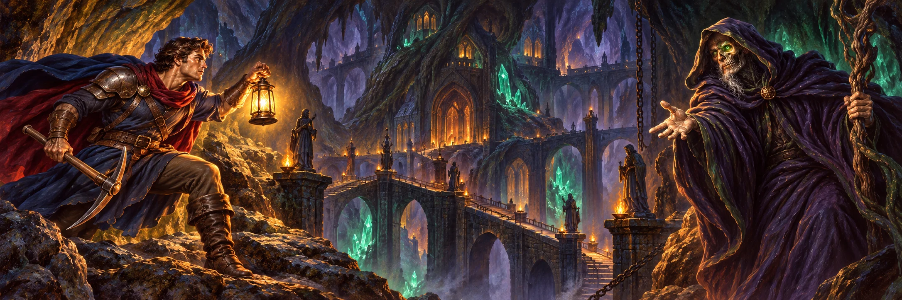
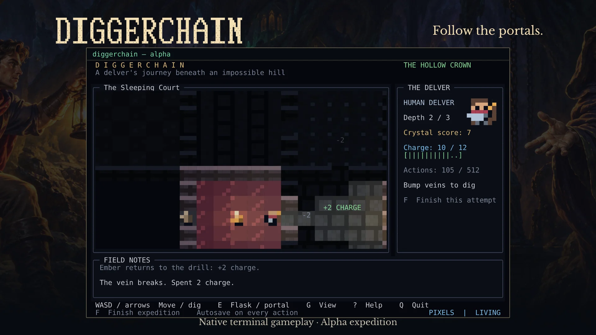

<p align="center"></p>
<h1 align="center">DiggerChain</h1>
<p align="center"><strong>A mining adventure in your terminal.</strong></p>
<p align="center"><a href="https://diggerchain.xyz/#demo">Play the demo</a> · <a href="https://diggerchain.xyz/#docs/download">Download</a> · <a href="https://diggerchain.xyz/#docs">Player guide</a> · <a href="https://diggerchain.xyz/#lore">Read the lore</a></p>



**0.1.0-alpha.1 · Offline play · No wallet required**

You found a cave. Inside it waits a castle that should not exist. Take a lantern, break through veins of rock, gather crystals, and find the portal below.

DiggerChain is a native terminal game with colored glyphs, half-block sprites, warm lighting, and fog of war. Play by hand or give its plain-text interface to your own agent. A static browser demo uses the same Rust simulation through WebAssembly.

The alpha is deliberately small: **three seeded castle floors, 512 successful actions, and automatic saves**. Backtrack through portals, replenish your digging charge, and keep what you have already uncovered. The generator varies a fixed chamber layout; there are no enemies or combat in this expedition. Unlimited descent and additional biomes are future work.

**Alpha has no token payouts.** The planned $DCG launch on Robinhood Chain and future gameplay rewards are separate milestones. See the [public roadmap](https://diggerchain.xyz/#roadmap).



## Download and play

Choose a native archive from [alpha 0.1.0-alpha.1](https://github.com/vanb0mmel/DiggerChain/releases/tag/v0.1.0-alpha.1). Each has a matching SHA-256 file.

| Platform | Download |
| --- | --- |
| Linux x86-64 | [ZIP](https://github.com/vanb0mmel/DiggerChain/releases/download/v0.1.0-alpha.1/diggerchain-0.1.0-alpha.1-linux-x86_64.zip) |
| Windows x86-64 | [Portable ZIP](https://github.com/vanb0mmel/DiggerChain/releases/download/v0.1.0-alpha.1/diggerchain-0.1.0-alpha.1-windows-x86_64-portable.zip) |
| macOS Apple silicon | [ZIP](https://github.com/vanb0mmel/DiggerChain/releases/download/v0.1.0-alpha.1/diggerchain-0.1.0-alpha.1-macos-arm64.zip) |
| macOS Intel | [ZIP](https://github.com/vanb0mmel/DiggerChain/releases/download/v0.1.0-alpha.1/diggerchain-0.1.0-alpha.1-macos-x86_64.zip) |

Extract it and run `diggerchain` (`diggerchain.exe` on Windows). No compiler, wallet, proving key, or network connection is needed to play. Linux needs glibc 2.34 or newer, such as Ubuntu 22.04. The recommended Windows build includes its C runtime. See [alpha installation](docs/ALPHA_INSTALL.md) for controls, saves, and the external-agent interface.

Available artifacts and publication status are tracked in [alpha release preparation](docs/ALPHA_RELEASE.md). Unbuilt platforms stay marked unavailable.

<!-- TOKEN_INFO_START -->
## $DCG on Robinhood Chain

Chain ID: **4663** · Contract address: **Coming Soon**

X / Twitter: **Coming Soon** · PonsFamily: **Coming Soon**
<!-- TOKEN_INFO_END -->

## Build from source

- Rust 1.89 or newer with Cargo, rustfmt, and Clippy (current stable recommended).
- A native linker: GCC/Clang on Linux, Xcode Command Line Tools on macOS, or Visual Studio C++ Build Tools on Windows with the MSVC Rust toolchain.
- A modern terminal with UTF-8, TrueColor, and a monospace font. Windows Terminal is a suitable Windows host.
- Internet access for the first Cargo dependency download.

Cargo installs the Rust dependencies: `crossterm` for terminal input, `serde` and `serde_json` for saves and responses, `sha2` for expedition identity, and `getrandom` for operating-system entropy. No SDL, GPU API, audio library, Node.js, or Python is required to build or run the game.

On CachyOS / Arch Linux:

```sh
sudo pacman -S --needed base-devel git rustup
rustup default stable
rustup component add rustfmt clippy
```

Rustup commands run as your regular user. If the distribution's `rust` package is already installed, use its toolchain or replace it with `rustup`; do not install conflicting toolchain packages together.

## Run

```sh
cargo run --release --locked
```

The default view uses top-down colored glyphs. Press `G` to switch to half-block pixel sprites. Fog of war is always enabled; revealing the scene is disabled for now. A terminal at least 90 columns by 30 rows is required; 120 by 40 or larger is recommended. Start with a normal monospace font and no extra line spacing. Font size controls the physical tile size.

| Key | Action |
| --- | --- |
| Arrows / WASD / HJKL | Move; bump a vein to dig |
| E / Enter | Use the flask or portal underfoot |
| G | Switch glyphs / sprites |
| Z / X | Zoom pixel sprites in / out |
| Space | Pause / resume ambient animation |
| ? | Show / hide help |
| F | Finish the expedition at its current score |
| Q / Escape | Quit |

Seek crystals, replenish charge, and find the portals to deeper floors. Crystal values increase with depth. F ends an attempt early; collecting one crystal and finishing does not mean every floor has been explored. Q saves and exits; run again to resume. Use `--new` for a fresh expedition; the previous save is archived. The protagonist has a human portrait, a pale cloak, a crimson scarf, and a brass pickaxe. The default glyph remains `@`.

Ordinary play works offline. The alpha archive contains the game, installation instructions, license notices, and checksums. The separate proof executable and testnet settlement tools remain development work for a later rewarded release; they are not part of alpha installation.

## Agent mode

Drive the same saved expedition without graphics:

```sh
cargo run --release --locked -- --headless
```

The program emits one JSON observation immediately, then one response per command. Commands: `look`, `north`, `south`, `west`, `east`, `dig-north`, `dig-south`, `dig-west`, `dig-east`, `interact`, `portal`, `wait`, `save`, `finish`, and `quit`. Movement and digging are separate protocol actions. `look` and `save` do not advance time. EOF exits cleanly. Standard output contains JSON only; no terminal or graphics is initialized.

See [expedition controls, saves, and protocol](docs/EXPEDITIONS.md). Observations expose visible objects and discovered terrain, not hidden floor grids or the private expedition secret. There is no embedded LLM provider, OAuth integration, or agent manager; an external agent drives the interface.

## Preserved prototype

```sh
cargo run --release --locked -- --prototype
cargo run --release --locked -- --prototype --headless
```

Pip and Moss remain goblins in this authored scene. Collect three singing crystals and bring them to the forest waystone. R restarts the playground. Its original headless commands remain `look`, `north`, `south`, `west`, `east`, `interact`, `wait`, `reset`, and `quit`. This mode has no persistent reward expedition. The independent baseline is documented in [PROTOTYPE.md](docs/PROTOTYPE.md).

## Workspace

- `crates/diggerchain-core`: deterministic simulation, authored scene, visibility, seeded expeditions, and versioned histories.
- `crates/diggerchain-terminal`: human-facing renderer and headless command adapter using the same core.
- [Static website](website/README.md): the approved title-screen Home, English player guide, and practice-only browser demo.
- `crates/diggerchain-web`: WebAssembly presentation adapter over the shared expedition rules; no wallet or rewards.
- [Feasibility fixture](crates/diggerchain-lab/README.md): isolated two-floor digging and resource experiment; no cryptographic proofs or rewards yet.
- [Bounded proof experiment](experiments/proof-lab/GENERATED.md): a passing generated 512-action proof and Robinhood testnet verification, with recorded measurements.
- `docs/ART_DIRECTION.md`: provisional visual direction and acceptance notes.
- [v1.0 roadmap](docs/ROADMAP.md): milestones, acceptance criteria, and testing ownership from the current prototype to release.
- [Preserved prototype](docs/PROTOTYPE.md): fixed baseline tag and independent working directory.
- [Reward rules draft](docs/REWARD_RULES.md): bounded fixture rules and unresolved production decisions.
- [Bounded reward protocol](docs/REWARD_PROTOCOL.md): saved expeditions, fixed parameters, ownership, and epoch payouts.
- [Reward testnet walkthrough](contracts/TESTNET.md): the user-run route from actual saved play to a token claim.
- [Native and public-parameter packaging](docs/PACKAGING.md): candidate archives, checksums, and platform build preparation.

## Development checks and future rewards

The user has passed 62 candidate checks, fixed setup, a real saved-game proof, and both testnet deployments. A complete registration and payout has not been observed. On 2026-10-22, the maintainer accepted the three-floor scope and deferred remaining tests to accelerate launch. Deferred checks are recorded as unrun, not passed; they do not block this release by the maintainer's decision. See [release status and roadmap](docs/ROADMAP.md).

The consolidated [smoke-test guide](docs/SMOKE_TEST.md) remains available for an optional future run:

```sh
bash scripts/smoke-test.sh
```

It runs checks, prepares a fixed testnet parameter set, and serves the public signing page through the native game. Wallet operations remain explicit user actions. Do not share the generated private player saves.

```sh
cargo fmt --all -- --check
cargo test --workspace
cargo clippy --workspace --all-targets -- -D warnings
cargo build --release
```

The user runs all tests and owns acceptance. The assistant prepares scenarios, commands, expected results, and fixes; test execution by the assistant requires explicit delegation. Automated checks cover the shared simulation and basic rendering invariants. Windows and macOS need native verification; Alpha tags trigger native builds for Linux, Windows, and both macOS architectures; compilation does not certify platform runtime behavior.
